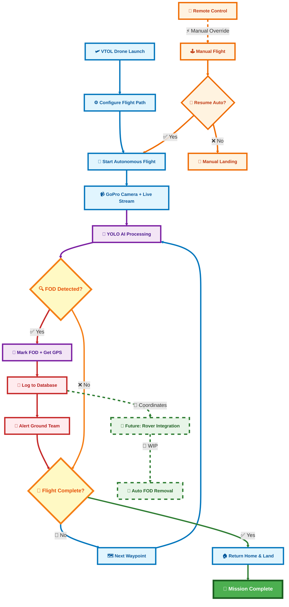

# 🛩️ Autonomous FOD Detection System using VTOL Drone

This project is a real-time Foreign Object Debris (FOD) detection system that uses YOLO ML Model on the server and a VTOL drone for automatic scanning and geo-tagging of debris on runways or racing circuits. Built for accuracy, safety, and automation.

---

## 🔍 System Overview

A VTOL drone conducts aerial scans and streams live video to the server. The server uses a trained AI model to detect debris in real-time. If any FOD is found, it marks its location, retrieves precise GPS coordinates from a telemetry module, logs them, and alerts the ground team.

Our YOLO model is trained on a hybrid dataset of 50,000+ images, combining public FOD datasets with custom-labeled drone footage across varied conditions. Integrated with ByteTrack, it assigns persistent IDs to detected debris, enabling stable, duplicate-free tracking even during motion or occlusion.

An automatic pick-and-place rover for FOD removal is currently a work in progress.

## 📊 System Flowchart


> ⚠️ Mermaid diagrams render only on the GitHub **website**. They may not display correctly in the GitHub **mobile app**.
---

## ⚙️ Components

### Hardware
- **VTOL Drone** – Capable of autonomous flight and manual override  
- **GoPro Camera** – Mounted on the drone for video capture  
- **VTX / HDMI TX-RX** – Transfers live video feed to the server  
- **Telemetry Module** – Provides real-time GPS data to the server  
- **RX Remote** – Manual control in conflict scenarios  

### Software
- **YOLO/AI Model** – Detects FOD in video frames  
- **Server** – Processes video, logs coordinates, and alerts ground team  
- **Database** – Stores FOD detection data for audit and review  
- **Alerting System** – Sends notification and co-ordinates upon detection  

---

## 🔁 Workflow

1. VTOL drone is launched and performs a configured autonomous flight
2. It streams live video to the server via VTX/HDMI TX-RX for low latency
3. The server analyzes each frame using a YOLO model trained for FOD detection
4. If FOD is detected:
   - Marked in video
   - Coordinates retrieved from telemetry module
   - Location logged into database
   - Ground team is alerted instantly
5. If no FOD is detected, drone continues or returns home safely

---

## 🧷 Folder Structure

| Path             | Description                         |
|------------------|-------------------------------------|
| `app.py`         | Core application logic              |
| `templates/`     | Frontend assets (HTML files)        |
| `README.md`      | Project documentation               |
| `Mermaid.js Mind Map` *(Embedded)*    | Visual Overview of the System Architecture        |


---

## 🔧 Autonomous Ground Rover & ROS Navigation Stack

The system integrates an **autonomous ground retrieval rover** designed to dispatch to marked FOD coordinates and clear runways in real-time.

### ROS Move Base Navigation Pipeline

The rover runs a ROS Melodic/Noetic navigation stack located in `catkinwsMOVEBASE`:

```
[ Aerial Drone / YOLO Detection ]
               │
               ▼  (GPS Lat/Lon + Approach Yaw)
      [ /add_waypoint ]
               │
               ▼
┌─────────────────────────────────────────────────────────────┐
│ waypoint_to_move_base.py                                    │
│ ├─ Geodesic Equirectangular Projection (Datum -> Map Frame) │
│ ├─ Target Orientation Quaternion Computation                │
│ ├─ Actionlib Goal Queue & Concurrency Management            │
│ └─ Distance Feedback & Preemption Watchdog                  │
└──────────────────────────────┬──────────────────────────────┘
                               │
               ▼  (MoveBaseGoal via Actionlib)
┌─────────────────────────────────────────────────────────────┐
│ ROS move_base Action Server                                 │
│ ├─ Global Costmap (Static Map + Obstacle Inflation)         │
│ ├─ Local Costmap (Rolling Window 6x6m, 0.05m Resolution)    │
│ └─ TrajectoryPlannerROS (DWA Local Planner)                 │
└──────────────────────────────┬──────────────────────────────┘
                               │
                               ▼  (/cmd_vel: Twist)
┌─────────────────────────────────────────────────────────────┐
│ diff_drive_controller.py                                    │
│ ├─ Differential Drive Inverse Kinematics                    │
│ ├─ Motor Calibration Trims & Saturation Limiting            │
│ └─ Watchdog Heartbeat (Auto-halt on telemetry timeout)      │
└──────────────────────────────┬──────────────────────────────┘
                               │
                               ▼  (/motor_speeds: Float32MultiArray)
                  [ Hardware Motor Drivers ]
```

### Sensor Fusion & Localization

Localization is achieved through an Extended Kalman Filter (`robot_localization` EKF node):
- **Wheel Encoders** (`wheel_encoders/wheel_encoder_node.py`): Optical pulse counters publishing wheel tick rates and odometry.
- **IMU / MPU6050** (`mpu6050/mpu6050_calib.py`): 6-DOF accelerometer and gyroscope publishing angular velocities and linear accelerations to `/imu/data`.
- **Compass & Magnetometer** (`compass_reader/hmc5883l.py` & `calib_compass.py`): Calibrated magnetic heading orientation with hard-iron offset compensation.
- **GPS Telemetry** (`compass_reader/neo7mgps_calib.py`): NMEA parser publishing WGS-84 fixes to `/fix`, converted to map coordinates via `navsat_transform_node`.

---


## 📜 License

This project is **not open-source**. All rights are **strictly reserved** by the original authors.  
Any reproduction, redistribution, or unauthorized use of the code, models, or ideas is **strictly prohibited** without prior written permission.

See `LICENSE.md` for full legal terms.

---

## 👨‍💻 Author
- Written and maintained by Moksh Dandotiya.
- Contact: moksh@duck.com

---


